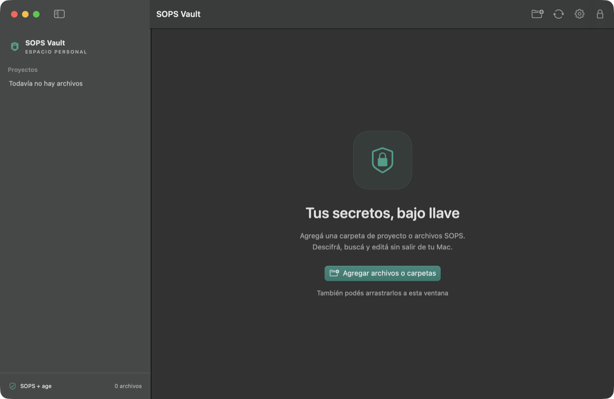

# SOPS Vault

A native macOS app (Swift + SwiftUI, macOS 14+) for viewing and editing secrets encrypted with
[SOPS](https://github.com/getsops/sops) + [age](https://github.com/FiloSottile/age).



- Add files or whole repositories (file picker or drag & drop). The app finds SOPS files
  (`*.enc.env`, `*.enc.yaml`, `*.enc.json`, or any YAML/JSON/ENV file containing `sops` metadata)
  and groups them by project (the folder holding `.git`).
- Values are hidden (`••••`) until you reveal them one by one. Copying puts the value on the
  clipboard, marked concealed/transient, and clears it after 30 seconds.
- Search by key name. Add, edit and delete keys, including nested JSON/YAML values and typed values.
  Edits stay pending (marked as new, modified or deleted, each undoable) until you click
  **Guardar cambios** (⌘S) in the top-right corner.
- Saving keeps the file in sync with git (see below), so the change is not left only on one Mac.
- Optional Touch ID / macOS password lock when the app opens, when the Mac sleeps and after
  5 minutes of inactivity.
- The interface is available in English and Spanish. It follows the macOS language (including the
  per-app language in System Settings), or you can pick one in Settings → General → Language.

## Sync with git

For a file tracked in a repository with an `origin` remote, SOPS Vault treats origin's default branch
as the source of truth:

- Opening a file runs `git fetch` and shows **origin's latest version**. The status bar says whether your
  working copy is up to date, behind (`git pull`), or has edits that are not in origin.
- **Update Local Copy** runs `git pull --ff-only` on the checked-out branch using its configured upstream. It requires a clean repository and no pending edits in the app; divergent branches are left for manual resolution.
- **Guardar cambios** fetches again and replays your pending edits key by key on origin's latest version.
  It then commits only that encrypted file on top of origin's branch and pushes. The commit is built with git
  plumbing on a temporary index: your checked-out branch, index and working tree are never touched, so
  `git pull` keeps working. Local hooks are skipped (`--no-verify`) because the commit only changes
  encrypted data. The commit message lists key names (already visible in SOPS files), never values.
- If someone changed one of the keys you edited to a different value in the meantime, nothing is saved
  until you choose **Usar mis valores** or **Usar los de origin**. Edits to other keys merge cleanly.
- If the branch is protected, the commit goes to a `sops-vault/…` branch and a pull request is opened with
  `gh` (or the compare page is linked). Later saves are added to that PR until it is merged or closed.
  The branch menu in the status bar can force a PR for every save in a repository.
- Offline, you can save the encrypted result only on this Mac. The next time you open the file, those
  edits are staged again for upload. After the upload, the working copy goes back to its committed
  version so `git pull` is not blocked.
- Files outside git, without `origin`, or ignored by git are saved in place, as before.

## Security model

- Decryption and encryption are done by your local `sops` binary. SOPS Vault never implements crypto itself.
- Decrypted values exist **only in memory**. They are never written to disk, `UserDefaults` or
  window restoration state. Locking the app drops them.
- Edits use `sops set` / `sops unset` on a **ciphertext-only** copy in a private `0700` staging
  directory next to the file. The result is decrypted and checked against the intended change before it
  is used: atomically renamed over the original for local files, or committed and pushed for synced
  files. No plaintext temp files are created, and the file's existing recipients are kept.
- Pending edits live only in memory. Locking the app or quitting discards them (quitting asks first).
- References are saved as security-scoped bookmarks. SOPS stderr is never shown, because parsers can echo values.
- The `sops` subprocess gets a minimal environment (`SOPS_AGE_KEY_FILE` and `PATH`). It does not inherit cloud credentials.

The lock protects the UI. Your age identity is still a regular file readable by your macOS user.

## Requirements

- macOS 14 Sonoma or later
- `brew install sops age` (SOPS 3.11 or later is needed for editing)
- An age identity, by default at `~/.config/sops/age/keys.txt`. You can change the identity and
  the `sops` path in Settings (⌘,).

## Build

```sh
swift build                 # debug build
./scripts/package.sh        # release build → dist/SOPS Vault.app (ad-hoc signed)
open "dist/SOPS Vault.app"
```

The app is ad-hoc signed, not notarized. The first time, right-click the app → **Open**, or run
`xattr -dr com.apple.quarantine "SOPS Vault.app"` if you downloaded it.

## Automatic updates

Each Mac can keep `/Applications/SOPS Vault.app` up to date by building signed releases from source.
Building locally means the app never carries a quarantine flag, so it runs without notarization.

```sh
# Trust your release signing key and install the hourly updater (LaunchAgent):
./scripts/install-updater.sh ~/.ssh/<signing-key>.pub
```

- The updater fetches tags from GitHub and takes the newest `vX.Y.Z` whose signature verifies against
  `~/.config/sops-vault/allowed_signers`. That file lives only on the Mac, so a pushed commit or tag
  cannot make itself trusted. Unsigned tags, or tags signed by another key, are skipped.
- It builds in `~/Library/Caches/io.github.jsred.sops-vault`, runs the test suite, and installs only if
  everything passes. If the app is open, the update waits until it quits.
- Logs: `~/Library/Logs/sops-vault-updater.log` (summary) and `sops-vault-build.log` (build output).

To publish a release, sign tags with an SSH key (`git config gpg.format ssh` and
`git config user.signingkey ~/.ssh/<signing-key>.pub` in this repo), then run:

```sh
./scripts/release.sh 1.2.0   # tests, signed tag v1.2.0, verification, push
```

## Tests

Integration tests generate a throwaway age key and fake fixtures in a private temp directory. They
run the real `sops` and `git` binaries (sync tests push to a local bare repository) and never touch
your real identity, repositories or remotes.

```sh
swift test                  # with Xcode
# Command Line Tools only (no Xcode): point the compiler at the Swift Testing macro plugin
swift test --disable-xctest -Xswiftc -plugin-path \
  -Xswiftc /Library/Developer/CommandLineTools/usr/lib/swift/host/plugins/testing
```

## Pre-push coverage gate

Install the repository hook once per clone (already installed in this checkout):

```sh
./scripts/install-hooks.sh
```

Pushes to the remote named `origin` require passing Swift tests and **at least 100% aggregate
line coverage across every `Sources/VaultCore/*.swift` file**. SwiftUI in `Sources/SOPSVault`
is not covered by the current test target. No VaultCore files are excluded; missing, empty or
invalid reports fail the check. The comparison uses exact counts, without rounding up.

The gate runs the process-heavy tests serially to avoid blocking the Swift concurrency pool.
The hook tests each distinct pushed commit tip (including tags) in a temporary source snapshot,
so uncommitted edits cannot make a failing commit pass. It leaves the checkout and index alone.
Deleting refs requires no coverage run. Each snapshot gets a fresh build; expect pushes to take
longer. Requirements are the same as the integration tests above, plus Python 3.

Run the same gate against your working files before committing:

```sh
./scripts/check-coverage.sh
python3 scripts/test-coverage.py  # regression tests for the policy and hook
```

A local Git hook can be bypassed with `--no-verify` and is not installed automatically by cloning.
Server-side enforcement would additionally require CI and branch protection. The app's encrypted
secret pushes explicitly skip hooks in the repositories it manages, as described above.

## Translations

Strings live in `Localization/<language>.lproj/Localizable.strings`. The keys are the English source
strings, so `en.lproj` stays empty. To add a language:

1. Copy `Localization/es.lproj` to `Localization/<code>.lproj` and translate the values. Keep the
   format arguments (`%@`, `%lld`, or positional `%1$@`) the same as in each key.
2. Add the code to `CFBundleLocalizations` in `scripts/package.sh` and to `Preferences.languages`.

`swift test` checks that every user-facing literal in the source has a Spanish entry and that the
translations keep the format arguments of their keys.

## Project layout

```
Sources/VaultCore   SOPS invocation, git sync, merge, discovery, bookmarks, document model (tested)
Sources/SOPSVault   SwiftUI app
Localization/       Localizable.strings per language (copied into the app bundle)
Tests/VaultCoreTests
scripts/            packaging and icon generation
```

## License

[MIT](LICENSE)
